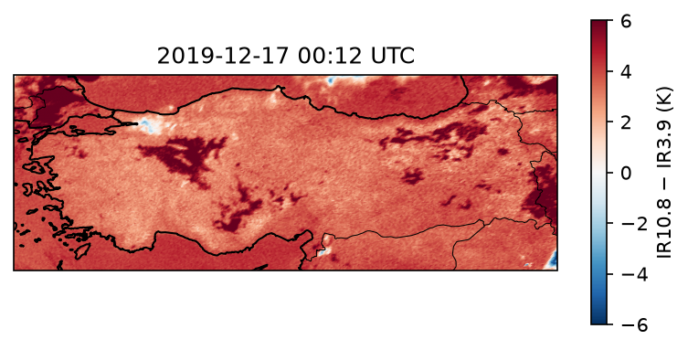

# turkey-fog


Fog detection over Turkey from MSG/SEVIRI satellite imagery, using airport METAR reports as ground truth.

> **Status:** work in progress. The matched dataset, a threshold baseline and first ML models (logistic regression, XGBoost) are in place; ERA5 features, more models and experiment tracking are next.

## Overview

Fog disrupts aviation and road traffic, but ground stations are sparse. This project builds a reproducible pipeline that

1. extracts fog events from METAR reports at Ankara Esenboğa Airport (LTAC), 2018–2024, using explicit visibility and present-weather criteria (77 fog events);
2. retrieves MSG/SEVIRI Level 1.5 data from the EUMETSAT Data Store with EUMDAC and processes it with Satpy;
3. pairs station observations with SEVIRI pixels to build an ML-ready dataset and compares a threshold baseline with ML classifiers.

## First result



On the night of 17 December 2019, during the longest fog event in the LTAC record (about 35 hours of continuous freezing fog, 16–18 December 2019), the station reported 200–300 m visibility and a vertical visibility of 100 ft. The SEVIRI IR10.8 − IR3.9 brightness temperature difference at the station pixel (black triangle) is +6.3 K, clearly above the clear-sky background of about +2 to +4 K. A single case, but consistent with the night-time fog signal this project builds on.

## Results

**Dataset.** 864 night-time SEVIRI scans matched to LTAC METAR reports (216 fog, 648 no fog). Features: brightness temperatures of the 8 thermal IR channels at the station pixel, and the centre, mean, maximum and standard deviation of IR10.8 − IR3.9 over a 5×5 pixel window (12 features). The data is split by year: training 2018–2022 (608 scans, 157 fog), test 2023–2024 (256 scans, 59 fog).

**Method.** Every threshold is chosen on the training years only: the BTD threshold by maximising CSI, and the models' probability threshold by 5-fold cross-validation grouped by night. The test years are used once. The 95% intervals come from 1,000 bootstrap resamples of whole test nights.

| Method | POD | FAR | CSI | CSI 95% interval |
|---|---|---|---|---|
| Threshold (BTD > 4.0 K) | 0.37 | 0.51 | 0.27 | 0.09–0.44 |
| Logistic regression | 0.59 | 0.53 | 0.35 | 0.20–0.48 |
| XGBoost | 0.58 | 0.24 | 0.49 | 0.30–0.65 |

POD: share of fog cases detected. FAR: share of fog predictions that were wrong. CSI: hits / (hits + misses + false alarms).

- XGBoost is clearly better than the threshold rule: the 95% interval of the CSI gain is 0.10 to 0.36. Most of the gain comes from fewer false alarms.
- The gain over logistic regression is likely but not certain (interval −0.01 to 0.30).
- The intervals are wide because the test years contain only 59 fog scans.

**Limitations.**
- The training years are mostly Meteosat-11, the test years mostly Meteosat-10, and fog BTD is lower in the test years (median 3.66 K vs 4.86 K). A same-season comparison of no-fog nights reversed the sign of the apparent satellite difference, so it is mostly seasonal and sampling effects, and no correction is applied. The 28 Meteosat-11 test scans contain no fog, so the satellite effect cannot be tested on the test set.
- One station only. Fog under higher cloud is not visible to the satellite: 7% of training and 17% of test fog scans have negative BTD.

## Repository structure

| Path | Contents |
|------|----------|
| `src/metar.py` | METAR loading and fog-flagging functions |
| `scripts/01_explore_metar.py` – `04_count_events.py` | METAR exploration, data completeness check, fog report counts, fog event grouping |
| `scripts/05_explore_btd.py` | SEVIRI loading with Satpy, IR10.8 − IR3.9 map over Turkey, station pixel value |
| `scripts/06_select_times.py` – `08_build_features.py` | Fog / no-fog time selection, SEVIRI download with EUMDAC, feature extraction |
| `scripts/09_baseline.py` | BTD threshold baseline |
| `scripts/10_xgboost.py` | Logistic regression and XGBoost, night-grouped CV, bootstrap intervals |
| `tests/` | pytest unit tests for the METAR functions |
| `docs/` | Data source notes and figures |
| `environment.yml` | Conda environment (Python 3.11, Satpy, EUMDAC, scikit-learn, XGBoost, …) |

## Setup

```bash
conda env create -f environment.yml
conda activate turkey-fog
pytest
```

SEVIRI downloads require a free EUMETSAT account and EUMDAC credentials (`eumdac set-credentials <key> <secret>`).

## Data sources

| Data | Source | Details |
|------|--------|---------|
| METAR, LTAC | [Iowa Environmental Mesonet (IEM)](https://mesonet.agron.iastate.edu/request/download.phtml) | 2018–2024, 124,483 reports, timestamps in UTC (verified against raw METAR codes) |
| MSG/SEVIRI Level 1.5 | [EUMETSAT Data Store](https://data.eumetsat.int), via EUMDAC | Native format (`.nat`), 15-minute full-disk scans |

Fog definition: visibility below 0.62 mi (≈1 km) and a present-weather code of FG or FZFG (BCFG, MIFG and PRFG excluded). Consecutive fog reports less than one hour apart are grouped into one event. Raw data is not stored in the repository; see `docs/data_sources.md`.

## Roadmap

- [x] METAR download, UTC check and fog event extraction for LTAC
- [x] First unit tests for the METAR functions
- [x] SEVIRI access via EUMDAC, Satpy processing and first IR10.8 − IR3.9 map
- [x] Continuous integration with GitHub Actions
- [x] Matched dataset: SEVIRI pixel windows paired with METAR fog / no-fog labels
- [x] Threshold baseline and ML classifiers with validation metrics
- [ ] ERA5 features (surface temperature, humidity, wind) to separate fog from low stratus
- [ ] Experiment tracking with MLflow and a Docker image for reproducible runs