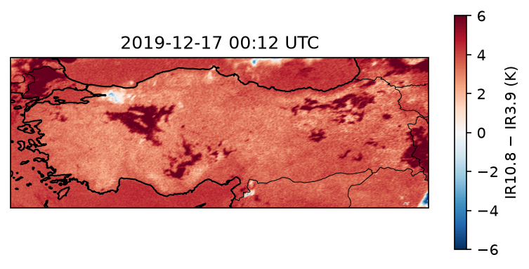

# turkey-fog


Fog detection over Turkey from MSG/SEVIRI satellite imagery, using airport METAR reports as ground truth.

> **Status:** work in progress. METAR fog labelling and first SEVIRI processing are in place; the matched ML dataset and baseline classifier are next.

## Overview

Fog disrupts aviation and road traffic, but ground stations are sparse. This project builds a reproducible pipeline that

1. extracts fog events from METAR reports at Ankara Esenboğa Airport (LTAC), 2018–2024, using explicit visibility and present-weather criteria (77 fog events so far);
2. retrieves MSG/SEVIRI Level 1.5 data from the EUMETSAT Data Store with EUMDAC and processes it with Satpy;
3. will pair station observations with SEVIRI pixels to build an ML-ready dataset and train a fog classifier.

## First result



On the night of 17 December 2019, during the longest fog event in the LTAC record (about 35 hours of continuous freezing fog, 16–18 December 2019), the station reported 200–300 m visibility and a vertical visibility of 100 ft. The SEVIRI IR10.8 − IR3.9 brightness temperature difference at the station pixel (black triangle) is +6.3 K, clearly above the clear-sky background of about +2 to +4 K. A single case, but consistent with the night-time fog signal this project builds on.

## Repository structure

| Path | Contents |
|------|----------|
| `src/metar.py` | METAR loading and fog-flagging functions |
| `scripts/01_explore_metar.py` – `04_count_events.py` | METAR exploration, data completeness check, fog report counts, fog event grouping |
| `scripts/05_explore_btd.py` | SEVIRI loading with Satpy, IR10.8 − IR3.9 map over Turkey, station pixel value |
| `tests/` | pytest unit tests for the METAR functions |
| `docs/` | Data source notes and figures |
| `environment.yml` | Conda environment (Python 3.11, Satpy, EUMDAC, …) |

## Setup

```bash
conda env create -f environment.yml
conda activate turkey-fog
pytest
```

SEVIRI downloads require a free EUMETSAT account and EUMDAC credentials (`eumdac set-credentials <key> <secret>`).

## Data sources

| Data | Source | Details |
|------|--------|---------|
| METAR, LTAC | [Iowa Environmental Mesonet (IEM)](https://mesonet.agron.iastate.edu/request/download.phtml) | 2018–2024, 124,483 reports, timestamps in UTC (verified against raw METAR codes) |
| MSG/SEVIRI Level 1.5 | [EUMETSAT Data Store](https://data.eumetsat.int), via EUMDAC | Native format (`.nat`), 15-minute full-disk scans |

Fog definition: visibility below 0.62 mi (≈1 km) and a present-weather code of FG or FZFG (BCFG, MIFG and PRFG excluded). Consecutive fog reports less than one hour apart are grouped into one event. Raw data is not stored in the repository; see `docs/data_sources.md`.

## Roadmap

- [x] METAR download, UTC check and fog event extraction for LTAC
- [x] First unit tests for the METAR functions
- [x] SEVIRI access via EUMDAC, Satpy processing and first IR10.8 − IR3.9 map
- [x] Continuous integration with GitHub Actions
- [ ] Matched dataset: SEVIRI pixel windows paired with METAR fog / no-fog labels
- [ ] Threshold baseline and ML classifier with validation metrics
- [ ] Experiment tracking with MLflow and a Docker image for reproducible runs
- [ ] Short results write-up