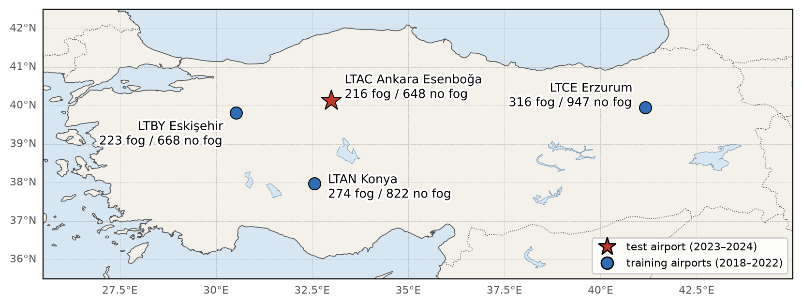
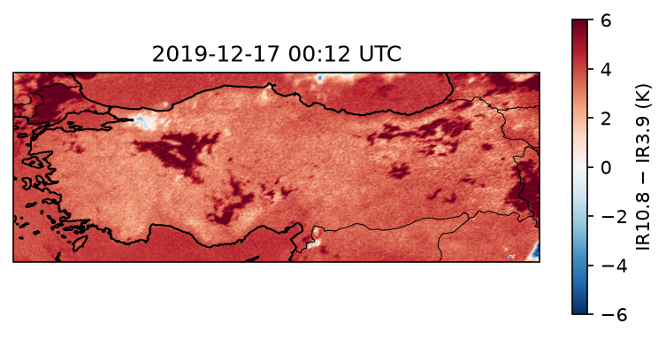

# turkey-fog


Night-time fog detection at Turkish airports from Meteosat (MSG/SEVIRI) satellite data and ERA5-Land weather data, using airport METAR reports as ground truth.

The project covers the whole chain: building an ML-ready dataset from three open data sources, comparing a physical threshold method with four ML models, testing on an airport and years the models never saw, and packaging the best model as a prediction tool in Docker.

## Main result

Tested on Ankara Esenboğa Airport (LTAC), 2023–2024: 256 night-time cases, 59 with fog. Models were trained on four airports, 2018–2022.

| Input data | Best model | CSI | 95% interval |
|---|---|---|---|
| Satellite only (SEVIRI) | XGBoost | 0.42 | 0.25–0.54 |
| Weather only (ERA5-Land) | Random forest | 0.53 | 0.31–0.67 |
| Satellite + weather | Neural network (MLP) | **0.75** | 0.60–0.85 |
| *Reference: BTD threshold* | – | 0.27 | 0.09–0.44 |

The best model finds 92% of fog cases (POD 0.92) and 19% of its fog alarms are false (FAR 0.19).

**ERA5 says when fog is possible, the satellite says whether it is there.** With weather data alone, the models find almost every fog case but about half of their alarms are false: humid, calm and cold nights do not always produce fog. The satellite removes most of these false alarms. For three of the four models, adding the satellite to ERA5 gives a clear gain (the 95% interval of the difference is above zero).

## Quick start

The prediction tool runs in Docker. Build the image once:

```bash
docker build -t turkey-fog .
```

**Offline example** (no internet or accounts needed). A foggy test-set night that the satellite-only model misses and the satellite + ERA5 model finds:

```bash
docker run --rm turkey-fog --example fog
```

```
Example: LTAC 2024-01-20 02:32:00 UTC (lon 32.9951, lat 40.1281)
METAR report at that time: FOG
  mlp        fog probability 0.20 (threshold 0.35) -> no fog
  mlp_era5   fog probability 0.92 (threshold 0.35) -> FOG
```

`--example clear` shows a clear night. Both examples are typical correctly classified test cases, chosen for the demo; the overall skill is in the table above.

**Live prediction** for any point and night-time hour. This needs an [EUMETSAT Data Store](https://data.eumetsat.int) key in `~/.eumdac/credentials` (one line: `key,secret`) and a [Google Earth Engine](https://earthengine.google.com) login. The credentials are mounted read-only at run time and never copied into the image:

```bash
docker run --rm \
  -v ~/.eumdac:/root/.eumdac:ro \
  -v ~/.config/earthengine:/root/.config/earthengine:ro \
  -v "$PWD/data/cache:/app/data/cache" \
  turkey-fog --time "2023-12-20 02:00" --lon 32.9951 --lat 40.1281
```

The tool:
- refuses daytime hours, because the model was trained on night-time data only;
- downloads the nearest SEVIRI scan and computes the satellite features;
- adds ERA5-Land values if they exist for that hour. For the last 5 days ERA5 is not published yet, so the tool uses the satellite-only model and says why. It does the same if ERA5 takes longer than `--era5-timeout` seconds (default 300) or if `--no-era5` is given;
- caches what it downloaded, so the same query is answered instantly the next time.

On Windows (Git Bash), put `MSYS_NO_PATHCONV=1` before `docker run` and use Windows paths for the folders, for example `"$(cygpath -m "$USERPROFILE")/.eumdac:/root/.eumdac:ro"`.

## How it works



**Labels.** METAR reports from four airports, 2018–2024, from the [Iowa Environmental Mesonet](https://mesonet.agron.iastate.edu/request/download.phtml). A report is fog when visibility is below 0.62 miles (1 km) and the weather code contains FG or FZFG as a whole code (BCFG, MIFG and PRFG do not count). Fog reports less than 1 hour apart (2 hours at hourly stations) form one event.

**Sampling.** Night only (solar zenith angle above 95°). Per airport, at most 75 fog events, and at most 6 reports per event, spread over the event, so that long events do not dominate. Non-fog cases are night-time reports at least 3 hours away from any fog report, three times as many as fog cases.

| Airport | Fog | No fog |
|---|---|---|
| LTAC Ankara Esenboğa (test) | 216 | 648 |
| LTAN Konya | 274 | 822 |
| LTBY Eskişehir | 223 | 668 |
| LTCE Erzurum | 316 | 947 |

**Satellite features.** For each case, the nearest MSG/SEVIRI scan (within ±10 minutes) from the EUMETSAT Data Store, read with [Satpy](https://satpy.readthedocs.io). A 5×5 pixel window around the airport gives 12 features: the brightness temperature of the 8 thermal infrared channels at the centre pixel, and the centre, mean, maximum and standard deviation of IR10.8 − IR3.9. This brightness temperature difference (BTD) is the classic night-time fog signal: fog droplets emit less at 3.9 µm than at 10.8 µm. Windows with any value below 150 K are dropped as invalid (one case, over a very cold cloud top).



*The BTD over Turkey during the longest fog event at LTAC (17 December 2019). At the airport pixel (black triangle) it is +6.3 K, above the clear-sky background of about +2 to +4 K.*

**Weather features.** Hourly [ERA5-Land](https://developers.google.com/earth-engine/datasets/catalog/ECMWF_ERA5_LAND_HOURLY) values from Google Earth Engine at each airport, matched to the nearest full hour: 2 m temperature, dew point depression (temperature minus dew point; near 0 means saturated air), 2 m temperature minus surface temperature (positive means the surface is cooling), and 10 m wind speed.

**Evaluation.** Training: all four airports, 2018–2022. Test: LTAC, 2023–2024, used once. Every threshold is chosen on the training data: the BTD threshold, and each model's probability threshold, by 5-fold cross-validation grouped by night (so that reports from one night never sit on both sides of a split). The 95% intervals come from 1,000 bootstrap resamples of whole test nights.

**Metrics.** CSI (critical success index) = hits / (hits + misses + false alarms); it is the intersection over union of the fog class. POD = share of fog cases found. FAR = share of fog alarms that were wrong. Accuracy is not reported: a model that always says "no fog" would score 77% on the test set.

## Results

**Does the model work at an airport it has never seen?** An earlier experiment with satellite features only (code in tag [`v0-scripts`](https://github.com/eapeker/turkey-fog/tree/v0-scripts)), test on LTAC 2023–2024, CSI:

| Trained on | Threshold | Log. regression | XGBoost | Random forest | MLP |
|---|---|---|---|---|---|
| LTAC only | 0.27 | 0.35 | 0.49 | 0.41 | 0.43 |
| LTAN, LTBY, LTCE (LTAC never seen) | 0.27 | 0.29 | 0.36 | 0.39 | 0.37 |
| All four | 0.27 | 0.34 | 0.41 | 0.43 | 0.42 |

Models trained on other airports still beat the threshold at LTAC, but lose skill. Adding LTAC's own history brings most of it back. More airports did not clearly beat training on LTAC alone; the differences are inside the 95% intervals. The best BTD threshold was 4.0 K on every training set.

**Satellite, weather or both?** Test on LTAC 2023–2024, training on all four airports, CSI ([reports/results.csv](reports/results.csv)):

| Model | SEVIRI | ERA5-Land | SEVIRI + ERA5-Land |
|---|---|---|---|
| Logistic regression | 0.34 | 0.51 | 0.63 |
| XGBoost | 0.42 | 0.47 | 0.63 |
| Random forest | 0.41 | 0.53 | 0.63 |
| MLP | 0.39 | 0.50 | **0.75** |

Adding ERA5-Land improves every model clearly. With ERA5-Land alone, POD is about 1.0 but FAR is about 0.5. The 95% intervals of the differences are in [reports/comparisons.csv](reports/comparisons.csv). Runs are tracked with MLflow.

## Limits

- **Small test set.** 59 fog cases at one airport, so the intervals are wide. Single runs of the random models move by a few points when the row order changes.
- **Night only.** In daytime the 3.9 µm channel also carries reflected sunlight, and the BTD signal no longer works.
- **Fog under higher cloud.** Infrared sees the top of the highest cloud. In the test years, 17% of fog cases have a negative BTD, a sign of cloud above the fog. Example: on 21 December 2023 02:00 UTC LTAC reported freezing fog. ERA5-Land was fog-friendly (dew point depression 1.6 K, wind 0.6 m/s), but the satellite saw a cold cloud top (245 K, BTD −1.0 K). The model followed the satellite and missed the fog (probability 0.26, threshold 0.35).
- **ERA5 is not real-time.** It is published about 5 days late, so operational use would need forecast model data instead, which is less accurate. ERA5 may also include these airports' own surface observations through data assimilation, so the gain could be smaller away from stations.
- **Satellite change.** The training years are mostly Meteosat-11 and the test years mostly Meteosat-10, whose BTD is about 0.6–1.1 K lower.

## Run the pipeline

All settings (airports, years, sampling, channels, split) are in [config.yaml](config.yaml). The pipeline runs step by step:

```bash
conda env create -f environment.yml
conda activate turkey-fog

python scripts/run_pipeline.py select     # pick fog and non-fog night-time cases from METAR
python scripts/run_pipeline.py download   # download SEVIRI windows (resumable)
python scripts/run_pipeline.py era5       # download ERA5-Land from Google Earth Engine
python scripts/run_pipeline.py features   # build the feature table
python scripts/run_pipeline.py train      # train, evaluate, log to MLflow, save models
python scripts/run_pipeline.py examples   # save the two offline examples

pytest                                    # unit tests
mlflow ui --backend-store-uri sqlite:///mlflow.db
```

GitHub Actions runs the tests, builds the Docker image and runs the offline examples inside it on every push.

## Repository

```
config.yaml              all settings
src/turkey_fog/          metar, seviri, era5, features, metrics, train, predict
scripts/run_pipeline.py  pipeline steps
scripts/predict.py       prediction tool (the Docker entry point)
scripts/plot_stations.py airport map
models/                  the two models used by the prediction tool
examples/                offline example nights
reports/                 results tables
tests/                   unit tests
docs/                    data sources and figures
```

## Next steps

- ERA5 low cloud cover and boundary-layer height, to help with fog under higher cloud.
- Forecast model data instead of ERA5, for real-time use.
- More airports, and a check on locations without a station.
- Daytime fog, which needs different features.

## Data sources

- METAR: Iowa Environmental Mesonet (IEM), ASOS/AWOS network, Iowa State University.
- MSG/SEVIRI Level 1.5 (High Rate SEVIRI, 0° service): EUMETSAT Data Store.
- ERA5-Land hourly: Copernicus Climate Change Service (C3S), via Google Earth Engine.

More details in [docs/data_sources.md](docs/data_sources.md). Licence: MIT, see [LICENSE](LICENSE).
